# OmniaCLI

<p align="center">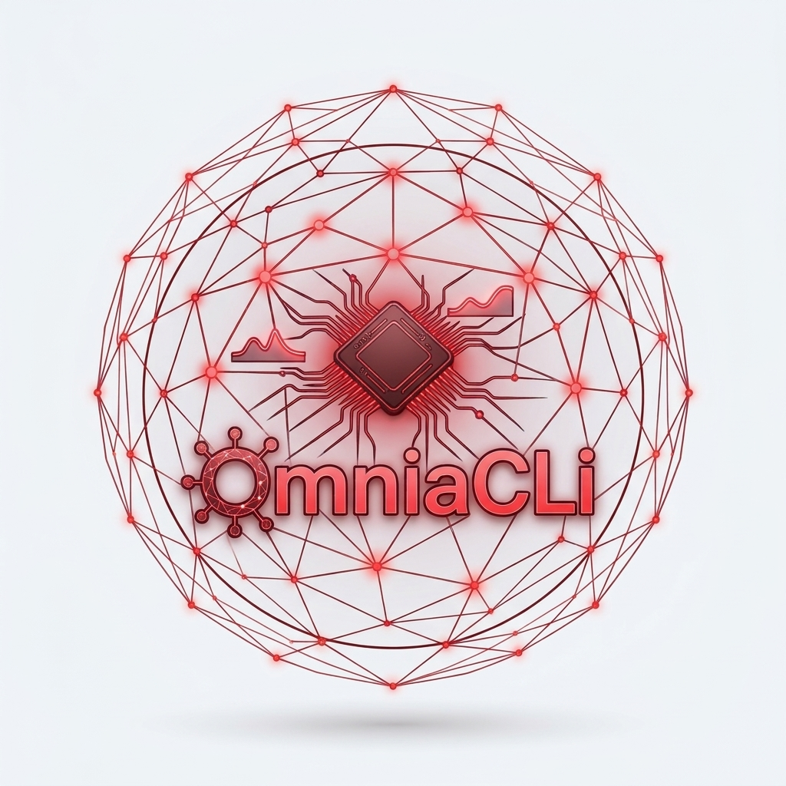</p>

Manage many Odoo instances from a single web interface.

OmniaCLI is a small web service, behind a login page, that deploys and
operates Odoo instances from git. Each **server** has a **production** and/or
a **test** instance. An instance has one or more git working copies, a
database, an Odoo config file, a log file and a systemd service, an init.d
script, or an Odoo that OmniaCLI starts itself.

- **Dashboard**: every server with the state of its Odoo, Start / Stop /
  Restart, its CPU, and the CPU, network and disks of the machine, with the
  day each disk will be full.
- **Deploy**: git pull (submodules included), update of the changed or chosen
  modules, restart; auto update in a time window; merge of what was tested
  into production, after a backup.
- **Backups** of database and filestore, to download; **copy of production
  into test**, neutralized.
- **Jobs** shown live; an administrator stops one that hangs.
- **Logs** in the browser, with an "errors only" filter.
- **Links**: operate the OmniaCLI of other machines from your own.
- **MCP**: AI clients (Claude Code and others) read, update test instances
  and back them up through a token.
- Users with roles (user, developer, admin), an access log, and a Help page.

## Quick start

On Debian 11–13 or Ubuntu 22.04/24.04 (amd64):

```bash
wget https://github.com/OmniaGit/OmniaCLI/releases/latest/download/OmniaCLI.deb
sudo apt install ./OmniaCLI.deb
sudo cat /etc/omniacli/initial-admin-password     # the password of user admin
```

OmniaCLI listens on `127.0.0.1:8090`: put an HTTPS reverse proxy in front of
it (see [Login and security](#login-and-security)), open it, log in as
`admin`, and add your servers on the **Servers** page.

## Screenshots

The screenshots show demo data.

**Login**

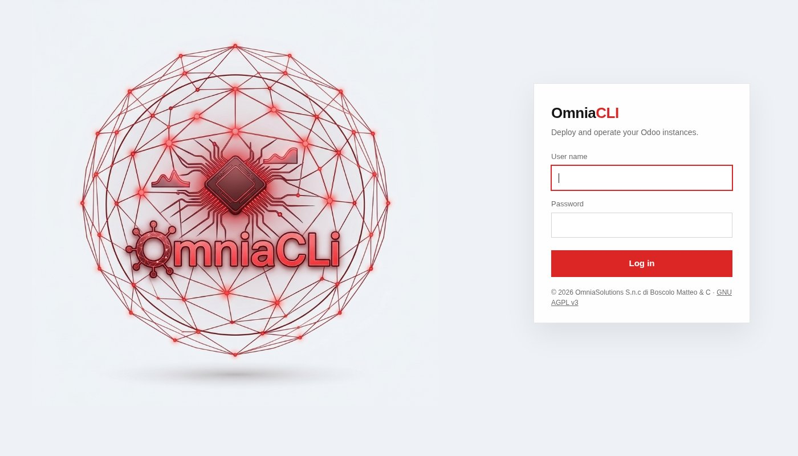

**Dashboard**: the servers with the state of their Odoo and their CPU, the
whole machine (CPU, network, disks) and the last jobs, updated as they run.
Every disk is recorded once a day (kept three years, in
`<data>/disk_history.json`): its panel row says when it will be full, from the
trend of the last 90 days (at least 7 days of data), and **Disks** (`/disks`)
charts each disk's used space with that forecast.

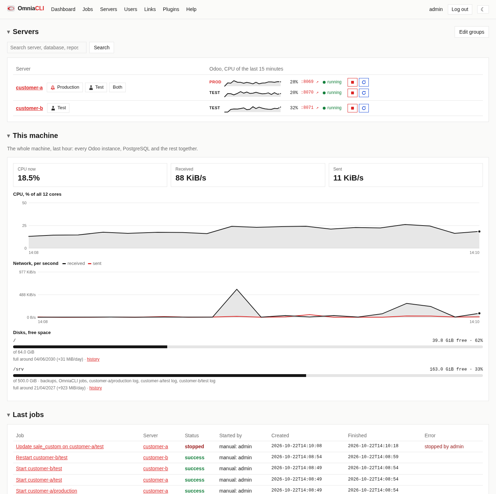

**Disks**: each disk's used space by day, with the dashed forecast up to the
day it is full.

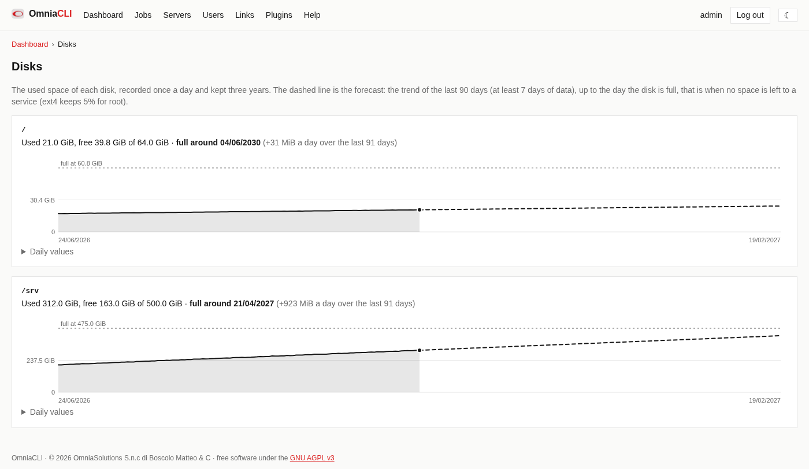

**A server**: production and test side by side, with their actions, load and
live log; *Merge test to production* and *Copy production to test* at the top.

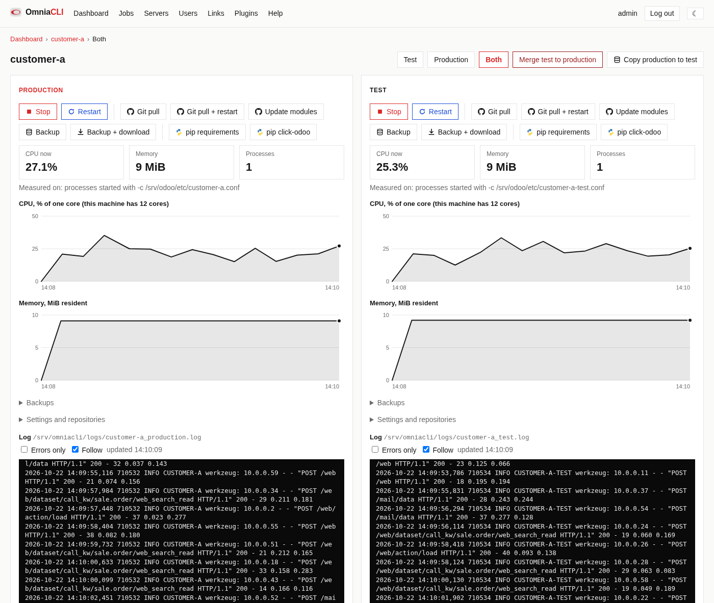

**Update modules**: the changed modules or chosen ones. The last choices of
modules of the instance come back as buttons (*Recent*).

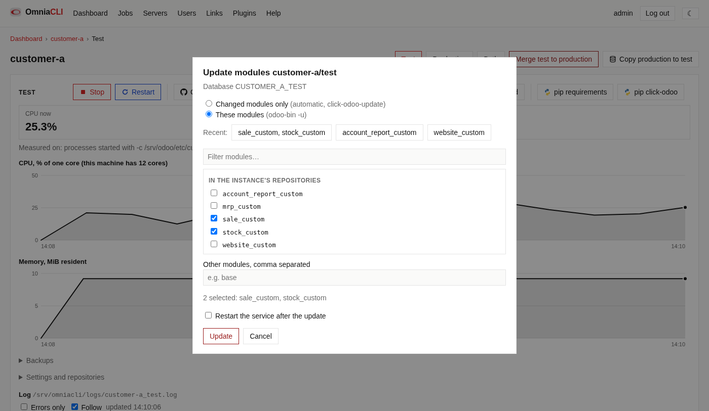

**Copy production to test**: a new backup of production, or one already made.

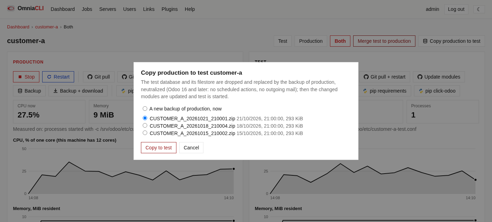

**Copy from link**: a backup made on a linked instance (a new one or one
already there), transferred here and restored; the job page follows each
step, the transfer with its size, speed and time left.

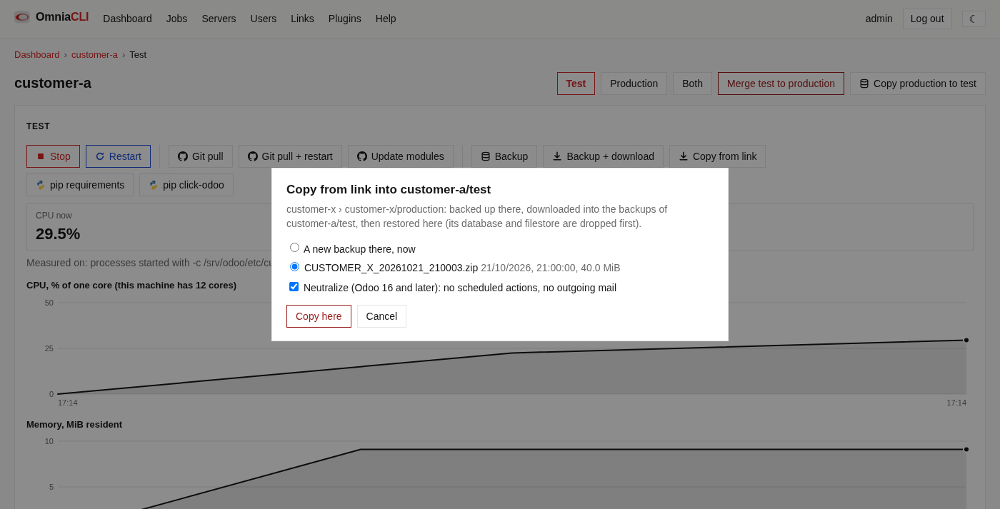

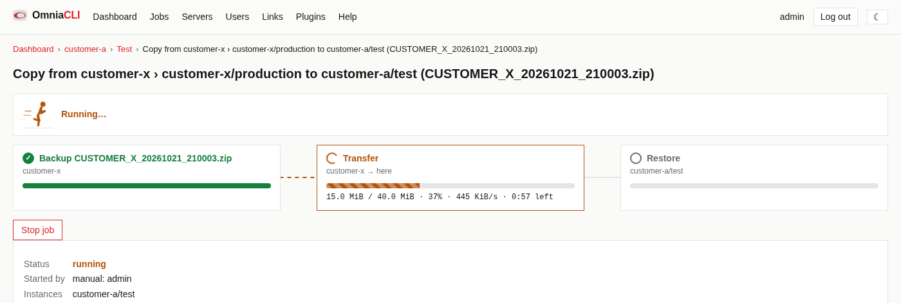

**A job**, and the **Servers** page where servers are added, tested and
activated.

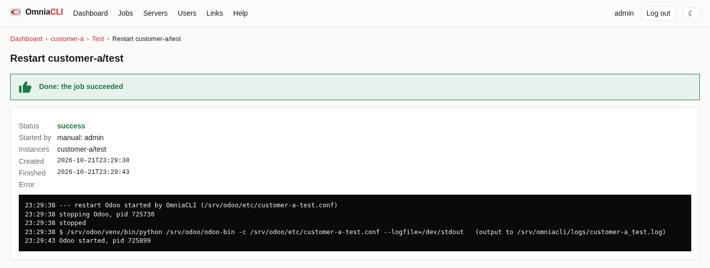

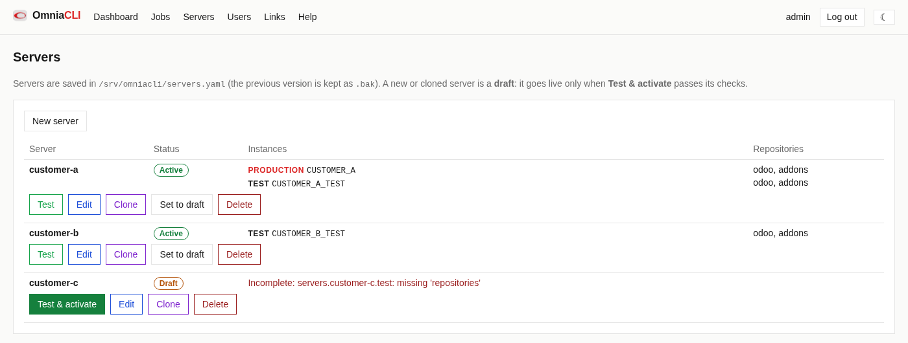

**A job stopped by an administrator**: a module update that never ended,
stopped with *Stop job*.

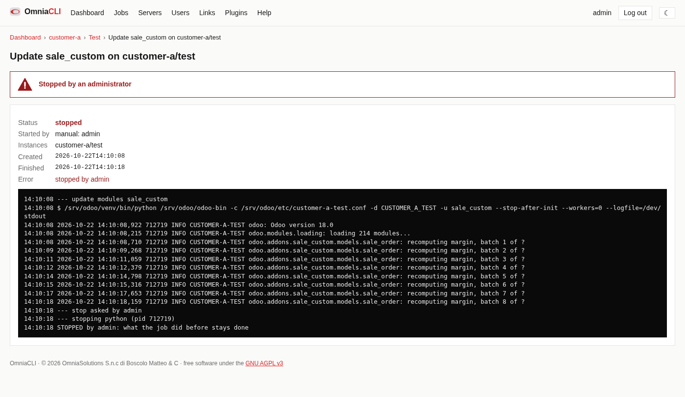

## What it does

| Action | Production | Test | What runs |
|---|---|---|---|
| Git pull | ✓ | ✓ | `git pull --ff-only <remote> <branch>` in every repository, then `git submodule update --init --recursive` in those with submodules |
| Git pull + restart | ✓ | ✓ | pull, `click-odoo-update` (only the changed modules), restart |
| Update modules | ✓ | ✓ | a popup asks: the changed modules (`click-odoo-update`) or chosen ones (`odoo-bin -u … --stop-after-init --workers=0`), and whether to restart after. The last 5 choices of modules of each instance are offered again; they are kept in the browser (`localStorage`), so each browser has its own |
| Restart | ✓ | ✓ | the instance's systemd or init.d restart, or OmniaCLI's own start of `odoo-bin` (see below) |
| Start, Stop | ✓ | ✓ | `systemctl start`/`stop` of a systemd service (each needs its sudoers line, the **Start/Stop permission** check prints them), or OmniaCLI's own Odoo; a stopped Odoo stays stopped for the auto update |
| Backup | ✓ | ✓ | `click-odoo-backupdb` → `<backup_dir>/<server>/<role>/<db>_<timestamp>.zip`, database and filestore; with **Without filestore** checked, the database only (`--no-filestore`), `<db>_<timestamp>_nofilestore.zip`. The backup before a merge always has the filestore |
| pip requirements | ✓ | ✓ | `<venv_bin>/python -m pip install -r` the `requirements.txt` next to `odoo-bin` and that of every repository having one, in one call |
| pip click-odoo | ✓ | ✓ | `<venv_bin>/python -m pip install click-odoo-contrib`, the scripts OmniaCLI runs in the venv |
| Merge test to production | | ✓ | backup production, merge, push, update modules, restart production |
| Copy production to test | ✓ → | ✓ | a popup asks which backup of production: a new one (with the filestore; without it, test has no attachments; or **shared with production**, see below) or one already made; then stop test, `click-odoo-restoredb --copy --force --neutralize` into the test database (drops it and its filestore first; `--neutralize` from Odoo 16: no scheduled actions, no outgoing mail), `click-odoo-update`, start test. **Filestore shared with production**: the backup is made without filestore, and after the restore test's filestore (`<data_dir>/filestore/<db>`) is a tree of hard links to production's files, made by the test's venv python as its `run_as` user: no extra disk space, test reads every attachment, and what test writes or deletes does not touch production's files (Odoo never rewrites a filestore file, it only writes new ones and unlinks). Refused, before anything is touched, when an Odoo config sets no `data_dir` or the two filestores are not on the same filesystem, or the test user may not link production's files (`fs.protected_hardlinks`). Refused when production and test run different Odoo versions, and on Odoo 20+ (click-odoo-restoredb refuses it). A systemd test needs its Start/Stop sudoers lines; an init.d one is not stopped, it is restarted at the end |
| Copy from link | ✓ (admin) | ✓ | for an instance with a **Database from link**: a popup asks which backup of that instance of the linked OmniaCLI: a new one, made there now (with or without the filestore; an OmniaCLI there older than 2026.1.12 makes it with the filestore), or one already there; whether to neutralize; and for a production its database name, typed. The zip is downloaded into this instance's backups as `<link>_<file>` (through `<file>.part`: a cut download leaves nothing), then restored as above: stop, `click-odoo-restoredb --copy --force [--neutralize]`, `click-odoo-update`, start. Refused, before anything is touched, when the backup's `manifest.json` names another Odoo version than the instance's |
| Log | ✓ | ✓ | `tail -F` of the Odoo log in the browser, with an "errors only" filter |

The two pip buttons are also next to the **Venv bin** field of the server
form (admins), as soon as it is set: they run on the venv, odoo-bin and
repository folders typed there, saved or not, so a draft's venv can be
prepared before Test & activate. The job's log opens in a new tab.

- **Dashboard**: one row per live server, with the CPU of production and
  test over the last 15 minutes. The server's name opens its page, for the
  maintenance: CPU and memory charts of the last hour, the actions, the
  settings and the live log. *Merge test to production* is on that page. The
  buttons **Production** and **Test** open the instance itself in a new tab,
  at its **Domain name** (server form) or at `http://localhost:<its port>`;
  the same link is next to the instance's name on the server's page.
- **Load**: every 5 seconds OmniaCLI samples each live instance. A systemd
  instance is measured on its unit's cgroup (cgroup v2): CPU of the main
  process and every worker, memory as the resident size of its processes. An
  init.d instance is measured on the processes started with `-c <its Odoo
  config>`. CPU is in percent of one core.
- **Draft and Test & activate**: a new or cloned server is a draft (no page,
  no actions, no auto update). *Test & activate* runs real checks as the
  OmniaCLI user and makes it live only when no check fails: Odoo config,
  addons path, log file, click-odoo scripts and an `import click_odoo, odoo`
  with the instance's python, the database (connected with the Odoo config's
  credentials), odoo-bin, every repository (branch, no local change, remote
  reachable), the service and `sudo -n -l` for its restart command, separate
  folders and databases for production and test, the backup folder. Saving
  a live server runs the same checks: if they fail nothing is saved and it
  stays live. `omniacli check-config` runs them from the command line.
- **Shell** (developers and admins, a button on each instance): a page with
  a terminal (xterm.js) running a login shell of the user OmniaCLI runs as
  (`omniacli`, or the one of `OMNIACLI_USER`; bash when its own shell is
  `nologin`), in the instance's first repository. It runs on a
  pseudo-terminal joined to the page by a WebSocket, and ends when the page
  closes: its whole session is hung up (SIGHUP, SIGKILL after 3 seconds).
  The shell of a linked instance's server opens through the link, with the
  lower of the link's role and the user's. Every shell opened and closed is
  in the access log, with who and for how long. It is the access of that
  system user, as SSH would give it: give the developer role accordingly.
- **Auto update**: per instance, every `interval_minutes` within `window`,
  OmniaCLI fetches every repository. When there are new commits it runs
  *git pull + restart* as an `auto` job.
- **Jobs**: every action is a job. Its output, its status and its error are
  shown live in the web page, and the last 500 are kept in `jobs_dir`.
- Only one job runs on an instance at a time; the others wait.
- **Stop job** (admins, on the page of a queued or running job): for a job
  that hangs or loops. The program it runs gets SIGTERM, with its whole
  process group (pip's builds, Odoo's workers), and SIGKILL after 10 seconds.
  The job ends as `stopped`, "stopped by <user>"; the steps after the stopped
  one do not run (a stopped module update is not followed by the restart),
  and what the job did before stays done. The instance is free for the next
  job at once. With `run_as` the SIGKILL reaches only `sudo`: a program of
  that user that ignores SIGTERM keeps running.

### Rules the actions follow

- A pull is **fast-forward only**. A repository on a branch other than the
  configured one, or with uncommitted changes, stops the job: OmniaCLI never
  creates merge commits or throws away local work on a pull.
- Except on a **test instance without auto update**, where someone may be
  working: its uncommitted changes are kept (a warning in the checks, not an
  error), and a pull goes on unless git would have to overwrite them.
  **Merge test to production** still refuses them: what runs on test must be
  a commit.
- The **submodules** of a repository follow it: after a pull, a merge or the
  rollback of a merge, `git submodule update --init --recursive` checks them
  out at the commits the repository records (a submodule left behind counts
  as an uncommitted change). Local changes inside a submodule make git
  refuse: the job stops, the repository itself already pulled, the changes
  kept. Their remotes must be readable by OmniaCLI's user without a prompt.
- **Merge test to production** merges the commit **checked out on the test
  server**, not the tip of the test branch, so production gets exactly what
  was tested. That commit must already be on the remote. Test and production
  repositories are paired by `name`. If any repository conflicts, the merge
  is aborted, every production repository is reset to the commit it had
  before, and nothing is pushed: the conflict is for a person to resolve.
- If a module update fails, the instance is **not** restarted.

## Install from the Debian package

Supported: Debian 11, 12, 13 and Ubuntu 22.04, 24.04 (amd64). OmniaCLI needs
Python 3.10 or newer: the package uses the system `python3` when it is 3.10+,
otherwise (Debian 11, Python 3.9) a local `python3.10`+ already installed (in
the `PATH` or `/usr/local/bin`, the newest first), otherwise it downloads a
Python 3.12 (python-build-standalone, checked against its sha256) into
`/opt/omniacli/python`.

Every [release](https://github.com/OmniaGit/OmniaCLI/releases) has the
package as `omniacli_<version>_all.deb`, and as `OmniaCLI.deb`, whose link
always gives the latest one.

```bash
sudo apt install ./omniacli_<version>_all.deb
sudo cat /etc/omniacli/initial-admin-password     # password of user admin
```

An upgrade is the same `apt install` of a newer package: the configuration,
the servers, the users, the jobs and the backups stay.

The package:

- creates the system user `omniacli` and runs the service `omniacli` as that
  user, on `127.0.0.1:8090` (change it in `/etc/default/omniacli`);
- runs it as another user when `OMNIACLI_USER` is set in
  `/etc/default/omniacli` (see below);
- builds `/opt/omniacli/venv` at installation with that Python and the
  dependency versions locked for it (`packaging/debian/requirements`).
  **The machine must reach PyPI while installing**, and also `github.com`
  when the Python 3.12 has to be downloaded. After an upgrade or a removal of
  the Python the venv was built on (a distribution upgrade, a local Python
  removed), rebuild it with `sudo dpkg-reconfigure omniacli`;
- creates `/etc/omniacli/omniacli.yaml` once, with a random password for
  `admin`; upgrades never change it;
- keeps the servers file, the jobs and the backups in `/var/lib/omniacli`;
- installs `/etc/sudoers.d/omniacli`, all comments, to be completed;
- on purge, deletes configuration and jobs but keeps the backups.

### The service as another user (OMNIACLI_USER)

On a development workstation the repositories, the Odoo configs and the logs
are the developer's, often in a folder other users cannot enter: the service
user `omniacli` cannot read them (`cannot read .../odoo.conf: Permission
denied`). Run the whole service as that user instead:

```bash
echo OMNIACLI_USER=mboscolo | sudo tee -a /etc/default/omniacli
sudo dpkg-reconfigure omniacli
```

Everything OmniaCLI does itself then runs as that user, in group `omniacli`:
git (with that user's git configuration and credentials), reading the
configs and logs, its files in `/var/lib/omniacli` (given to that user, and
kept so by upgrades). The sudoers lines name that user
(`mboscolo ALL=(root) NOPASSWD: ...`). Not root. Remove the line and run
`dpkg-reconfigure` again to go back to `omniacli`. On a server keep
`omniacli`, with `run_as` for the programs of an Odoo venv.

### Build and test the package

```bash
packaging/debian/build_deb.sh                  # test build -> ARTEFACTS, omniacli_<year>.1.<n>_all.deb
packaging/debian/build_deb.sh --release        # release build of branch <year> -> ARTEFACTS, OmniaCLI.deb
packaging/debian/build_deb.sh --check DIR      # the working tree, into DIR, no tag
packaging/debian/build_deb.sh --ci VERSION DIR # the checked out commit with VERSION, into DIR (the CI)
packaging/debian/test_deb.sh <deb> [image ...] # install and check it in Docker, systemd included
packaging/debian/make_locks.sh                 # regenerate the dependency locks, with the tests
```

The package is built from a commit (`git archive`), never from uncommitted
files, except with `--check`. Its version is `<year>.1.<n>`. The test and
release builds number `n` one above every `omniacli-v<year>.1.*` tag and every
package already in `ARTEFACTS`, and tag the built commit. `ARTEFACTS` (where
the package goes, `dist/` by default) and `PYTHON` (the Python that builds the
wheel, `python3` by default) come from the environment or from
`packaging/debian/build.local.sh`, a file of the build machine that is not
versioned.

### Releases on GitHub

Publishing a GitHub release builds its package
(`.github/workflows/release.yml`):

1. tag the commit to release with its version, `omniacli-v<year>.1.<n>`, and
   publish a release on that tag;
2. the workflow runs the tests, builds the package with
   `build_deb.sh --ci <version>` and attaches `omniacli_<version>_all.deb`
   and `OmniaCLI.deb` to the release;
3. it then installs the package in Debian 12 and Ubuntu 24.04 containers with
   systemd and checks it end to end (`test_deb.sh`). A failure there marks
   the run as failed: the package is already attached, so delete it from the
   release, or publish a fixed release.

## Install by hand

```bash
python3.11 -m venv /opt/omniacli/venv
/opt/omniacli/venv/bin/pip install git+https://github.com/OmniaGit/OmniaCLI.git
```

The `click-odoo-*` scripts import the instance's own `odoo` package. So
`click-odoo-contrib` must be installed **in the venv that runs each Odoo**,
not in OmniaCLI's venv. `venv_bin` in the config points to it.

```bash
/opt/odoo/venvs/odoo18/bin/pip install click-odoo-contrib
```

`click-odoo-update` keeps a hash of every installed module in the database.
On a database it has never seen, it would update every module. So run this
once per database, when you know the modules are up to date:

```bash
/opt/odoo/venvs/odoo18/bin/click-odoo-update -c odoo.conf -d DB --only-compute-hashes
```

## Configure

The configuration has five files:

- the **main config** (`omniacli.yaml`): the users set by hand, `backup_dir`,
  `jobs_dir`, `servers_file` and `users_file`. It is edited by hand and the
  web interface never writes it.
- the **users file** (`users_file`, by default `users.yaml` next to the
  servers file): the users, links and MCP tokens managed from the web
  interface (**Users** page, admins only), written readable by its owner
  only. Every change applies at once: a changed or deleted password stops
  working at the next request.
- the **links file** (`links_file`, by default `links.yaml` next to the
  servers file): the other OmniaCLI instances this one operates (**Links**
  page, admins only), with their tokens in clear, so written readable by its
  owner only.
- the **groups file** (`groups_file`, by default `groups.yaml` next to the
  servers file): the headings of the Dashboard (**Edit groups**, admins).
- the **servers file** (`servers_file`, see `servers.example.yaml`): the
  servers and their instances. It is edited from the web interface
  (**Servers** page: new, edit, clone, delete), so the user running
  OmniaCLI must be able to write it. Every save is validated like the file at
  startup, the previous version is kept as `<file>.bak`, and the auto update
  loops restart with the new settings. Clone copies a server's configuration
  only (no database, no files). A server with a running job cannot be edited or
  deleted.

```bash
cp config.example.yaml omniacli.yaml
omniacli hash-password            # paste the result under auth.users
omniacli check-config -c omniacli.yaml
```

`check-config` checks that every path is readable, that the click-odoo
scripts exist and that every repository is on its configured branch.

### Roles

Every user has a role:

| Role | May |
|---|---|
| `user` | watch: servers, load, logs, jobs, the backup list; and restart, start and stop Odoo |
| `developer` | also act on the servers: pull, update, backup and the download of a backup, pip, the shell |
| `admin` | everything: also the configuration pages and the merge of test into production |

```yaml
auth:
  users:
    admin: "pbkdf2_sha256$..."                 # a bare hash: an admin
    anna: {password: "pbkdf2_sha256$...", role: developer}
    luca: {password: "pbkdf2_sha256$...", role: user}
```

The pages show only what the role allows, and the server refuses the rest
(403).

The **Users** page adds users, changes their role, sets a new password and
deletes them. The users of the main config are shown there too but are
changed only in the file: they are the way in that a mistake on the page
cannot lock out. Nobody can change their own role or delete themselves, and
the last admin cannot be demoted or deleted. Every user who logs in with a
password changes it from their own page (their name, top right), unless it is
set in the main config.

The **Help** page (menu Help, developers and admins) explains step by step
how to create a link, how to connect an MCP client and every field of the
server form, with example data only.

The **Access log** (Users page, admins) lists the logins with date, time and
address: a user's login is the login form; a link or an MCP token, which send
their token with every request, log in with their first request after 30
minutes without requests from the same address. Logouts, every wrong password
or token, and the logins refused for too many failures are listed, and so is
every call to `/mcp`, with its JSON-RPC method and tool, and every shell
opened and closed. It is kept in
`access.jsonl` in the logs folder next to `jobs_dir` (`/var/lib/omniacli/logs`
for the package); past 5 MiB it moves to `access.jsonl.1`.

### Linked instances

Another OmniaCLI instance (yours, at the customer's) can be let in to operate
this one with a token of its own and a role. Create it on the **Users** page
(the token is shown once), or by hand in `auth.links`:

```bash
omniacli new-link-token omniasolutions --role developer
```

```yaml
auth:
  links:
    omniasolutions: {token: "sha256$...", role: developer}
```

The linking instance sends the token as `Authorization: Bearer <token>`.
It may also send `X-OmniaCLI-Prefix` (the path it serves these pages under,
e.g. `/links/customer`: every link in the pages starts with it) and
`X-OmniaCLI-User` (its user acting through the link: the jobs record
`manual: link omniasolutions (anna)`), and `X-OmniaCLI-Role-Cap` (that
user's role on the linking instance: the link acts with the lower of it and
its own). They are honoured for link tokens only. `GET /api/info` answers
with the version and the caller's role, `GET /api/servers` with the live
servers.

### Operating another instance

On your instance, the **Links** page (admins) adds a link: a name (the
customer's), the other instance's URL, the token it created for you on its
Users page, and a CA file when its certificate is from the customer's own CA.
**Test link** shows its version and the role you get there. Then:

- the Dashboard lists its live servers as `<link> › <server>`, with their
  load, and the filter finds them by link name too. A link that does not
  answer is shown as an error above the list;
- its pages open here under `/links/<link>/`, with a bar saying which
  instance you are on: every action runs there, recorded as
  `manual: link <its name for you> (<your user>)`;
- you act there with the lower of your role here and the link's role there.
  Only users who log in here use links, not tokens;
- an instance here may take its database from an instance there: in the
  server form, **Database from link** names the link, the server there and
  its role. *Copy from link* on the instance's page then backs it up there,
  downloads the zip and restores it here (see the table of actions). It needs
  the developer role there (for the link and for you) and here, the admin
  role for a production here. Stopping the job here does not stop a backup
  already running there.

### Groups

With many servers, **Edit groups** on the Dashboard (admins) puts them
under headings, in the order you choose. A member is `srv` (a server of this
instance), `*` (all of them), `customer/srv` (a server of a link) or
`customer/*` (all the servers of a link); a server shows under the first
group that has it, the rest under "Other servers". The filter finds a server
by its group name too. The groups are this instance's own: a linked
instance's pages do not show them.

The other instance must be reachable from yours: through an HTTPS reverse
proxy, a VPN, or an SSH tunnel (`http://` is accepted for a tunnel or a VPN,
but then the token travels in clear). Both instances need a version with
links (the Test link button says so).

### Permissions

The user that runs OmniaCLI needs:

- to **own** the repositories (or have them listed in its git
  `safe.directory`): git refuses to work in a repository owned by another
  user ("dubious ownership"). It also needs git credentials for `fetch`/`push`
  that need no prompt (an SSH key without a passphrase, or a credential
  helper). Git is never allowed to ask.
- read access to the Odoo config and log files.
- a database connection: `click-odoo-*` connect with the settings of the
  instance's Odoo config file.
- **or**, with `run_as: <user>` on the instance (the user of the Odoo
  service, usually `odoo`), the right to run the venv's programs as that
  user: `click-odoo-update`, `click-odoo-backupdb`, `odoo-bin -u`, pip and the
  checks then run as `sudo -n -u <user>`, so the database is reached as that
  user (PostgreSQL `peer` login on the socket included), and so are the
  filestore and the venv. git still runs as OmniaCLI's user. The venv's
  folder in sudoers allows its programs, `SETENV` passes `PYTHONPATH` (the
  folder of `odoo-bin`). These programs start in `/`, not in OmniaCLI's own
  folder (`/var/lib/omniacli`, which that user cannot enter). The **Run as**
  check prints the line:

  ```
  omniacli ALL=(odoo) NOPASSWD:SETENV: /opt/odoo/venvs/odoo18/bin/
  ```

  A backup made as that user is written in `/var/tmp` first, then moved
  into the backup folder. Not with restart type `process`: OmniaCLI stops
  its own Odoo with a signal, which it may not send to another user's
  process.
- the right to restart the services without a password. With `sudo: true`
  (the default), the command runs as `sudo -n`. sudoers needs the full path
  that `command -v systemctl` prints on that machine. Example
  `/etc/sudoers.d/omniacli`:

```
omniacli ALL=(root) NOPASSWD: /usr/bin/systemctl --no-ask-password restart odoo-customer-a
omniacli ALL=(root) NOPASSWD: /etc/init.d/odoo-customer-a-test restart
```

### Configuration cases

Problems met putting OmniaCLI on an existing Odoo 18 server (Odoo as the
systemd service of user `odoo`, instances with `run_as: odoo`), each with
what the check or the job said, the cause and the fix. Paths are examples.

**"Odoo config: Permission denied", "Log file … is not readable".** The
checks run as `omniacli`. The Odoo configs were `640 odoo:odoo` and
`/var/log/odoo` was `750 odoo:odoo`: readable files in a folder `omniacli`
cannot enter are not readable either. Both are readable by group `odoo`, so:

```bash
sudo adduser omniacli odoo
sudo -u omniacli head -c 1 /etc/odoo/odoo.conf; echo " $?"   # 0: readable
sudo systemctl restart omniacli     # the service gets the new group only when it starts
```

`omniacli` then reads everything group `odoo` reads. To give it only these
files, use ACLs instead (`setfacl -m u:omniacli:r <config>`,
`setfacl -m u:omniacli:rx /var/log/odoo` and `setfacl -d -m u:omniacli:r
/var/log/odoo` for the files logrotate creates). An Odoo config left `666`
during tests is readable and writable by every user of the machine (its
database password; an `addons_path` that runs their code as `odoo`): put it
back to `640`.

**"fatal: detected dubious ownership in repository".** The repositories
belonged to `odoo` (`755`), and git runs as `omniacli`. `safe.directory` alone
is not enough when `omniacli` cannot write there: the pull would then fail.
Give OmniaCLI the repositories it manages:

```bash
sudo chown -R omniacli:odoo /opt/odoo/repos/customer
sudo -u omniacli -H git -C /opt/odoo/repos/customer status --short
```

Odoo keeps reading the code (the folders stay `755`). From then on pull as
`omniacli` (`sudo -u omniacli -H git …`), not as `odoo` or root. The first
`git status` after the `chown` takes a while on a big repository (git
refreshes its index): it is not stuck. Run every manual git command on these
repositories as `omniacli` too, `git … remote -v` included: root gets the same
"dubious ownership".

**"remote origin branch 18.0 not reachable: could not read Username for
'https://github.com': terminal prompts disabled".** `omniacli` had no git
credentials, and OmniaCLI never lets git ask for them. A deploy key of
`omniacli` on the GitHub repository, then the remote on SSH:

```bash
sudo -u omniacli -H mkdir -p -m 700 /var/lib/omniacli/.ssh
sudo -u omniacli -H ssh-keygen -t ed25519 -N '' -f /var/lib/omniacli/.ssh/id_ed25519
sudo -u omniacli -H sh -c 'ssh-keyscan github.com >> ~/.ssh/known_hosts'
# add the .pub as a deploy key of the repository on GitHub
sudo -u omniacli -H git -C /opt/odoo/repos/customer remote set-url origin git@github.com:<owner>/<repo>.git
sudo -u omniacli -H git -C /opt/odoo/repos/customer ls-remote origin 18.0
```

A read-only key is enough for the checks and the pulls. *Merge test to
production* pushes, so it needs **Allow write access**; where whoever merges
the code brings it to production on GitHub, keep the key read-only and leave
the merge to them (with a read-only key the button's push fails after the
local merge, which then has to be undone by hand). Production and test clones
of the same GitHub repository share one key.

**"test repositories without a production repository of the same name".**
*Merge test to production* pairs repositories by `name`: give the test
repository the name of its production one (`customer` in both); path and
branch stay different.

**A module update fails with `PermissionError: … 'ezdxf.ini'`.** A program run
as `odoo` started in OmniaCLI's folder, `/var/lib/omniacli` (`750`), and a
library (ezdxf, imported by an Odoo module) looks for its ini file in the
current folder. Since 2026.1.11 programs run as another user start in `/`.
On an older version, `sudo chmod 751 /var/lib/omniacli` works around it; put
it back to `750` after the upgrade.

**A repository stays " M lib/three.js" after `git reset --hard`.** That path
is a git submodule (a library inside an Odoo module), never initialised on
the server: a reset does not touch submodules, and the check counts a
submodule off its commit as an uncommitted change. `git submodule update
--init` fixes it. Since 2026.1.11 OmniaCLI does it after every pull and merge
(see [Rules the actions follow](#rules-the-actions-follow)); the submodules'
remotes must be readable by `omniacli` without a prompt.

**"Failed to restart odoo.service: Interactive authentication required".**
The restart ran `systemctl` without `sudo`: the instance's restart had
`sudo: false`. Turn **Use sudo -n** on in the server form, and allow the
commands in sudoers with the full path `command -v systemctl` prints:

```
omniacli ALL=(root) NOPASSWD: /usr/bin/systemctl --no-ask-password restart odoo.service
omniacli ALL=(root) NOPASSWD: /usr/bin/systemctl --no-ask-password start odoo.service
omniacli ALL=(root) NOPASSWD: /usr/bin/systemctl --no-ask-password stop odoo.service
```

`sudo -u omniacli sudo -n -l /usr/bin/systemctl --no-ask-password restart
odoo.service` prints the command when the line matches. The start and stop
lines are for the Start and Stop buttons and *Copy production to test*;
the **Start/Stop permission** check says which are missing.

**`<string>:38: (ERROR/3) Unexpected indentation` in an update job.** These
are docutils messages about a module's badly indented RST description: the
update goes on. When it fails, the job shows where Odoo stopped
(`Error: while parsing …/data/….xml`), the reason (the traceback) is in the
Odoo log, which the **Log** page shows once `omniacli` can read it.

**A link or an MCP client to an OmniaCLI behind a self-signed certificate.**
The linking OmniaCLI verifies it with the link's **CA file**: the server's
certificate itself (with its IP in `subjectAltName`), copied to the linking
machine and readable by `omniacli` there. Claude Code runs on Node, which
does not use that file: start it with
`NODE_EXTRA_CA_CERTS=<that certificate>`.

## Odoo started by OmniaCLI (restart type `process`)

For an Odoo that has no service, OmniaCLI can start it itself:
`<venv_bin>/python <odoo-bin> -c <odoo_config>`, in its own session. Its
output goes to `<jobs_dir>/../logs/<server>_<role>.log` (the logfile of the
Odoo config is overridden), and that file is the instance's log; its pid is
kept next to it (`.pid`).

- Restart stops OmniaCLI's Odoo (SIGTERM to its process group, SIGKILL after
  60 s) and starts it again. It refuses when another process runs with the
  same Odoo config (started from a console, an IDE, a service): OmniaCLI
  never stops a process it did not start.
- Stop stops it, and it stays stopped until Start (the same button as
  Restart): the auto update still pulls and updates its modules, but does
  not start it again. Stop exists only for this type: a service is stopped
  with its own tools.
- Odoo keeps running when OmniaCLI stops, restarts or is upgraded: the
  package's unit has `KillMode=process`, and OmniaCLI finds its Odoo again from
  the pid file.
- Odoo runs as the user of OmniaCLI: that user needs write access to Odoo's
  `data_dir` (filestore, sessions).
- Odoo is not started at boot: a Restart starts it.

## MCP interface

OmniaCLI serves an MCP endpoint at `/mcp` (streamable HTTP) for AI clients.
It needs the `mcp` SDK, so Python 3.10 or newer, which the package always
provides: OmniaCLI installed by hand on Python 3.9 runs without it.

| Tool | What it does |
|---|---|
| `list_servers` | every server, active or draft, with its instances |
| `server_status` | repositories (branch, last commit), Odoo running, CPU and memory, auto update, last jobs |
| `pending_updates` | commits not yet pulled, per repository (`git fetch`) |
| `read_log` | the last lines of an instance's log, optionally only ERROR/CRITICAL with their tracebacks |
| `list_jobs`, `get_job` | the jobs, filtered by server and text, and a job's log |
| `update_test` | **the only action on Odoo**: git pull + update of the changed modules + restart of the **test** instance |
| `backup_test` | a backup (database and filestore) of the **test** instance; `options: {"no_filestore": true}` for the database only |
| `backup` | (admin token) a backup of any instance, **production** too; the same `options` |
| `list_backups` | (admin token) an instance's backups, each with its download path |
| `read_server` | (admin token) a server's whole configuration, active or draft |
| `add_draft_server` | (admin token) a new server, always a **draft**: it goes live only with Test & activate on the web |
| `dev_setup` | what a client needs to rebuild an instance locally: remote URLs (without credentials), branches, commits, `addons_path` as repository folders, Odoo and Python versions, the Odoo config options without secrets nor server paths, and the backups to download |

With an admin token `dev_setup`, `backup` and `list_backups` also reach the
draft servers (saved complete), and their backups download with that token;
every other tool works on the active servers only.

Access is by bearer token, never by the users' passwords. Create one per
client on the **Users** page (the token is shown once), or by hand: add its
hash to `auth.tokens`:

```bash
omniacli new-token dev-laptop --role admin
```

```yaml
auth:
  users: ...
  tokens:
    dev-laptop: {token: "sha256$...", role: admin}
```

A token has a role, as a user does: `user` reads, `developer` also runs
`update_test` and `backup_test` and downloads backups, `admin` also has the
tools marked admin above. A client sees only the tools of its role. A token
saved without a role (a bare hash, as before roles) is a `developer`.

Then, in Claude Code:

```bash
claude mcp add --transport http omniacli https://omniacli.example.com/mcp \
    --header "Authorization: Bearer <token>"
```

A token also opens the pages for reading, which is how a client downloads a
backup (`GET <base URL>/backups/...` with the same header); it can never
POST to them.

## Run

```bash
omniacli serve -c omniacli.yaml --host 127.0.0.1 --port 8090
```

### Login and security

Users log in on the login page; the browser then holds a session cookie
(`HttpOnly`, `SameSite=Strict`, `Secure` over HTTPS) for **8 hours** from the
login, and **Log out** ends it on the server. The server keeps only a hash of
each session, in `sessions.json` next to `jobs_dir` (mode 600), so a restart
does not log anybody out; a changed password or a deleted user ends that
user's sessions at once. After 5 wrong logins within 15 minutes from an
address or for a user name, every further try waits 30 seconds, doubled each
time up to 15 minutes. HTTP Basic is not accepted: scripts and AI clients use
tokens (MCP), other OmniaCLI instances use link tokens.

Every page is sent with `X-Frame-Options: DENY` and `Content-Security-Policy:
frame-ancestors 'none'` (no framing by other sites), `X-Content-Type-Options:
nosniff`, `Referrer-Policy: same-origin`, and over HTTPS
`Strict-Transport-Security`. Expose OmniaCLI only through an HTTPS reverse
proxy that keeps the `Host` header: POSTs are accepted only when their
`Origin` matches `Host`, which blocks cross-site requests, and the password
must never travel in clear. The same holds for the WebSocket of the shell,
which the proxy must pass on; for nginx, in the `location` of OmniaCLI:

```nginx
proxy_http_version 1.1;
proxy_set_header Upgrade $http_upgrade;
proxy_set_header Connection "upgrade";
proxy_set_header Host $host;
proxy_read_timeout 1h;   # an idle shell stays open up to this
```

Without them the shell page says "refused or connection lost".

## Develop

```bash
pip install -e '.[test]'
pytest
```

The tests use real git repositories in a temporary folder, and fake
`click-odoo-*` scripts and restart commands.

### Plugins

A type of server (Odoo, and later others) is a plugin: a subclass of
`omniacli.plugin_api.ServicePlugin`, declared by its package as an entry point
of the group `omniacli.plugins`:

```toml
[project.entry-points."omniacli.plugins"]
odoo = "omniacli_odoo:OdooPlugin"
```

`omniacli/plugin_api.py` is the contract and the only module a plugin
imports. The core does what every type shares (the git repositories, the
service, the jobs, the auto update, users and links); the plugin reads its own
settings of an instance, checks it for Test & activate, does what follows a
pull, the backup and the command of a process OmniaCLI starts. A server names
its type in the servers file (`type: odoo`; none is `odoo`). At start every
plugin is checked against the contract (plugin API version, the methods it
must have, its name, its own `self_test`): one that fails is disabled, and
the **Plugins** page (admins) says why. The servers of a type without its
plugin are kept as written, without actions, until it is back.

A plugin may also give:

- **`fields()`**: its settings of an instance, which the server form draws
  (with buttons next to a field that call the plugin's routes: Odoo's
  *Reload* of the Odoo config, its *pip* buttons);
- **`actions()`**: buttons of its own on the server page. The core checks the
  role, runs the action as a job of the instance (or of the whole server) and
  draws a confirm, a dialog of parameters, or a dialog of the plugin's own
  template; they are posted to `/servers/<server>/<role>/x/<plugin>/<action>`;
- **`router(host)`**: a FastAPI router served under `/x/<plugin>/` (login
  needed; `host.needs(role)` for more), with its own templates
  (`templates_dir`, which may extend `base.html`) and static files
  (`static_dir`, at `/x/<plugin>/static/`);
- **`dev_setup()`** and **`mcp_help`**: its part of the MCP tool `dev_setup`
  and of the MCP instructions;
- **`backup_fields()`**: the choices of a backup (Odoo: without filestore),
  given to **`backup()`** as options; a checkbox not posted is off, and off
  is the backup made without any choice;
- **`restore()`** and **`restore_fields()`**: load a backup zip into an
  instance, with the choices asked first (Odoo: neutralize). The core's
  *Copy from link* is offered only for a type that has it.

Two plugins are built in: **generic** (git repositories and a systemd or
init.d service, nothing else: what an install without plugins has) and
**Odoo** (`omniacli/odoo`, which imports only `plugin_api`). The core imports
neither: it reaches them through the contract only.

## Acknowledgements

OmniaCLI's work on the Odoo instances rests on
[click-odoo](https://github.com/acsone/click-odoo) and
[click-odoo-contrib](https://github.com/acsone/click-odoo-contrib) by
[ACSONE SA/NV](https://github.com/acsone) and their contributors:
`click-odoo-update` updates the changed modules and `click-odoo-backupdb`
backs up the databases. Without their work this interface would not have
been possible: thank you.

OmniaCLI also builds on [Odoo](https://www.odoo.com), and on FastAPI,
Starlette, Uvicorn, websockets, Jinja, HTTPX, PyYAML and the MCP Python SDK.
The terminal of the shell page is [xterm.js](https://github.com/xtermjs/xterm.js)
with its fit addon (MIT, shipped in `omniacli/static`).

## License

Copyright (C) 2026 OmniaSolutions S.n.c di Boscolo Matteo & C.

OmniaCLI is free software: you can redistribute it and/or modify it under
the terms of the GNU Affero General Public License as published by the Free
Software Foundation, either version 3 of the License, or (at your option) any
later version. It is distributed in the hope that it will be useful, but
WITHOUT ANY WARRANTY; without even the implied warranty of MERCHANTABILITY or
FITNESS FOR A PARTICULAR PURPOSE. See the GNU Affero General Public License
in [LICENSE](LICENSE) for more details.

Whoever runs a modified OmniaCLI for users over a network must offer those
users the source code of that version (section 13 of the license).
